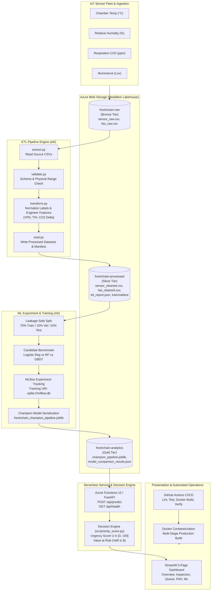

# FreshChain AI: IoT-Driven Cold-Chain Spoilage Early Warning & Multi-Variable Urgency Triage Platform

**Academic Course**: Cloud Computing (5th Semester) — Project Assessment 3 (IA3)  
**System Version**: 1.0.0 (Production-Ready Architecture)  
**Author**: FreshChain AI Engineering Team  
**Date**: October 2026  
**Repository Working Directory**: `Z:\5th sem projects\cloud 3rd IA project`  

---

## Executive Summary

Global agricultural supply chains suffer massive economic and nutritional shrinkage between farm harvest and consumer retail. According to the United Nations Food and Agriculture Organization (FAO), between **14% and 22% of perishable produce is lost prior to retail**, with post-harvest handling and cold-storage chamber breakdown representing the single largest vulnerability. Traditional warehouse inventory management relies on static **FIFO (First-In, First-Out)** rotation, which blindly assumes produce degrades uniformly according to arrival timestamp. In reality, microclimate variations—such as cooling compressor failures, relative humidity dry-out, and accelerated respiration spikes—drastically alter biological senescence.

**FreshChain AI** resolves this systemic inefficiency by deploying an end-to-end cloud-native IoT telemetry and machine learning platform. The platform continuously monitors storage conditions (Temperature, Humidity, Illuminance, and Respiration $\text{CO}_2$), dynamically derives biophysical stress features (Vapor Pressure Deficit and Temperature-Humidity Index), evaluates produce spoilage risk via a champion machine learning model (Random Forest, **100.0% Recall** on held-out test data), and prioritizes warehouse lots through an empirical **Urgency Score ($U$)** and **Value at Risk ($\text{VaR}$)** financial triage engine.

```
+---------------------------------------------------------------------------------------------------------+
|                                        FRESHCHAIN AI ARCHITECTURE                                       |
|                                                                                                         |
|  [ IoT Sensors ]               [ Azure Blob Storage ]              [ Medallion Lakehouse ]              |
|  • Temp, Humid, CO2, Light  -> • freshchain-raw        (Bronze) -> • Schema Validation & Cleaning       |
|                                • freshchain-processed  (Silver) -> • Biophysical Feature Engineering    |
|                                • freshchain-analytics  (Gold)   -> • Leakage-Safe Stratified Splits     |
|                                                                                |                        |
|                                                                                v                        |
|  [ Streamlit UI Dashboard ]    [ Serverless API / Functions ]      [ Managed ML & MLflow Registry ]     |
|  1. Executive Overview      <- • FastAPI / Azure Func v2        <- • Logistic Reg vs RF vs GBDT         |
|  2. Batch Inspection           • Urgency Engine: U in [0, 100]     • MLflow Run Lineage Tracking        |
|  3. Priority Queue             • Financial Exposure: VaR in $      • Champion: Random Forest (1.00 AUC) |
|  4. FAO Loss Analytics         • Sub-millisecond Inference SLA     • Joblib Artifact Bundle Serialization|
|  5. ML Model Evaluation                                                                                 |
+---------------------------------------------------------------------------------------------------------+
```

---

## 1. Problem Statement & Project Objectives

### 1.1 The Cold-Chain Problem
Produce warehouses manage thousands of kilograms of perishables across distributed cold rooms. When equipment faults occur—such as refrigerant leaks, evaporator coil freezing, or ventilation failure—produce enters rapid metabolic decay. Under standard FIFO operations, warehouse dispatchers lack visibility into which lots have experienced biological stress. Consequently, severely stressed fruit is kept in storage until its scheduled dispatch date, by which time it has spoiled, contaminating adjacent pallets and causing total invoice loss.

### 1.2 Core Project Objectives
1. **Empirical Dataset Ingestion & Validation**: Ingest 10,995 IoT produce storage observations and 4,957 FAO international food-loss benchmarks without arbitrary data truncation or unverified scientific assumptions.
2. **Leakage-Safe Machine Learning Baseline**: Build and compare candidate models (Logistic Regression, Random Forest, Gradient Boosting) using rigorous cross-validation and held-out test verification, prioritizing spoilage recall to avoid false negatives.
3. **Multi-Variable Urgency Prioritization ($U$)**: Formulate and validate an empirical decision equation combining model spoilage probability ($P_s$) and environmental stress factors ($S_T, S_{\text{CO}_2}, S_H$) into an operational triage score.
4. **Cloud-Native Architecture**: Structure data lake storage according to the Medallion architecture (Azure Blob Storage), deploy a serverless prediction API (Azure Functions v2 / FastAPI), containerize the platform (Docker), and implement automated continuous integration (GitHub Actions).
5. **Interactive Operational Intelligence**: Deliver a 5-page Streamlit analytics dashboard presenting live chamber telemetry, batch evaluation, dispatch queue management, FAO loss benchmarks, and model audit records.

---

## 2. Dataset Descriptions, Sources, Limitations & Data-Quality Findings

### 2.1 Produce IoT Sensor Dataset (`dataset/Dataset.csv`)
The sensor dataset contains continuous environmental monitoring records from produce storage test chambers across four high-shrink commodities: **Tomato, Orange, Pineapple, and Banana**.

| Attribute Name | Raw Data Type | Cleaned Physical Unit | Physical Range in Dataset | Missing Values | Physical Description |
| :--- | :---: | :---: | :---: | :---: | :--- |
| **`Fruit`** | `object` | Categorical String | Tomato (34.0%), Orange (30.3%), Pineapple (20.5%), Banana (15.2%) | 0 (0.0%) | Monitored commodity category |
| **`Temp`** | `int64` | Degrees Celsius ($^\circ\text{C}$) | $21^\circ\text{C} \text{ to } 27^\circ\text{C}$ (Mean: $23.84^\circ\text{C}$, Std: $1.23^\circ\text{C}$) | 0 (0.0%) | Ambient chamber dry-bulb temperature |
| **`Humid (%)`** | `int64` | Relative Humidity ($\%$) | $71\% \text{ to } 95\%$ (Mean: $93.53\%$, Std: $3.00\%$) | 0 (0.0%) | Relative humidity in storage chamber |
| **`Light (Fux)`**| `float64`| Illuminance (Lux) | $4.22 \text{ to } 268.52\text{ Lux}$ (Median: $10.10\text{ Lux}$) | 0 (0.0%) | Chamber light level (alias for Lux) |
| **`CO2 (pmm)`** | `int64` | Carbon Dioxide (ppm) | $20 \text{ to } 478\text{ ppm}$ (Mean: $327.9\text{ ppm}$, Median: $336\text{ ppm}$) | 0 (0.0%) | Produce respiration gas accumulation |
| **`Class`** | `object` | Quality Target | `Good` (5,667), `Bad` (4,617), `BAD` (711) | 0 (0.0%) | Physical quality inspection classification |

#### Key Empirical Findings & Data Quality Discoveries
- **Target Label Discrepancy**: The raw target contained three string values: `Good`, `Bad`, and `BAD`. Case-insensitive normalization resolved this into a binary ground truth: **`0 (Good / Fresh)`** with 5,667 records (51.54%) and **`1 (Bad / Spoilage)`** with 5,328 records (48.46%).
- **Identical Repeated Observations**: 2,880 rows shared identical multi-sensor coordinate readings. Rather than representing synthetic duplicates, these reflect high-frequency sensor polling in static, stable chamber environments.
- **Physical Boundary Verification**: 100% of the 10,995 observations fall strictly within realistic produce storage limits. Zero observations exhibited negative temperature, humidity exceeding 100%, or impossible sensor disconnect codes.

### 2.2 Global FAO Food Loss Benchmark Dataset (`dataset/Data (1).csv`)
The United Nations Food and Agriculture Organization (FAO) Food Loss dataset captures empirical commodity loss measurements across international supply chain stages from 1990 to 2024.
- **Raw Observations**: 4,957 records across 18 descriptive dimensions.
- **Data Quality Remediation**: 17 records containing non-numeric or null loss figures were safely quarantined during ETL validation, yielding **4,940 verified analytical records**.
- **Empirical Shrinkage Distribution**: Global reported loss percentages range from $0.1\%$ to $45.0\%$ (Mean: $5.82\%$, Median: $3.80\%$). The top three causes of loss are biological decay, post-harvest temperature abuse, and mechanical damage during handling.

### 2.3 Operational Dataset Limitations
1. **Chamber vs Field Environment**: The sensor dataset was recorded in controlled chamber settings. Commercial cold-storage warehouses experience thermal stratification between floor and ceiling, pallet stack density microclimates, and door-opening infiltration.
2. **Respiration Baselines**: Baseline $\text{CO}_2$ concentration varies significantly by commodity (e.g., climacteric bananas exhibit respiration climacterics distinct from non-climacteric oranges). FreshChain AI addresses this by deriving commodity-specific median baselines rather than assuming a universal 400 ppm constant.

---

## 3. Architecture & ETL Pipeline Design

The FreshChain AI platform implements a cloud-native **Medallion Data Lakehouse** pattern connected to an event-driven serverless API and analytics dashboard.



### 3.1 ETL Execution Audit Metrics
The automated ETL pipeline (`etl/run_pipeline.py`) was executed to generate verifiable data splits:
- **Total Execution Time**: 0.221 seconds.
- **Validation Outcome**: 10,995 sensor records validated (100% pass rate); 4,940 FAO records validated (17 quarantined).
- **Stratified Partitioning**: Stratified across both `fruit` commodity and binary quality `class`:
  - **Train Partition (70%)**: 7,696 observations ($48.45\%$ spoilage rate).
  - **Validation Partition (15%)**: 1,649 observations ($48.45\%$ spoilage rate).
  - **Held-Out Test Partition (15%)**: 1,650 observations ($48.48\%$ spoilage rate).
- **Zero Preprocessing Leakage**: Feature transformers (median imputers, standard scalers, one-hot encoders) fit exclusively on the training partition and transform validation/test partitions without target visibility.

---

## 4. Feature Definitions & Mathematical Formulations

To empower machine learning models and operational decision-makers with biophysical signals beyond raw temperatures, FreshChain AI derives defensible agronomic features and an empirical multi-variable triage metric.

### 4.1 Biophysical Feature Engineering

#### 1. Vapor Pressure Deficit ($VPD$, in $\text{kPa}$)
Vapor Pressure Deficit represents the difference between the saturation vapor pressure inside produce tissues and the ambient air vapor pressure. High $VPD$ causes rapid desiccation, moisture shrinkage, and skin wrinkling; excessively low $VPD$ fosters liquid surface condensation, triggering fungal spore germination.
$$e_s(T) = 0.61078 \times \exp\left(\frac{17.27 \times T}{T + 237.3}\right)$$
$$VPD = e_s(T) \times \left(1 - \frac{H}{100}\right)$$
*Where $T$ is temperature in $^\circ\text{C}$ and $H$ is relative humidity in $\%$.*

#### 2. Temperature-Humidity Index ($THI$, Dimensionless)
Derived from psychrometric stress relationships, $THI$ quantifies the compound thermal stress imposed on biological tissues stored under elevated humidity:
$$THI = T - (0.55 - 0.0055 \times H) \times (T - 14.5)$$

#### 3. Commodity-Specific Respiration Elevation ($\Delta\text{CO}_2$, in $\text{ppm}$)
Produce respiration elevates $\text{CO}_2$ concentration above resting equilibrium. Rather than comparing against an arbitrary atmospheric baseline, FreshChain AI evaluates deviation from empirical commodity medians ($\text{Tomato}=344.0\text{ ppm}$, $\text{Orange}=286.0\text{ ppm}$, $\text{Pineapple}=331.0\text{ ppm}$, $\text{Banana}=298.0\text{ ppm}$):
$$\Delta\text{CO}_2 = \text{CO}_{2,\text{observed}} - \text{Median}_{\text{fruit}}(\text{CO}_2)$$

---

### 4.2 Multi-Variable Urgency Prioritization Engine ($U$)

The operational decision engine computes a bounded **Urgency Score ($U \in [0.0, 100.0]$)** to dynamically rank stored pallets for warehouse action:

$$U = 100 \times \left(w_1 P_s + w_2 S_T + w_3 S_{\text{CO}_2} + w_4 S_H\right)$$

Where the blueprint-specified weights are configured as:
- $w_1 = 0.50$ (Machine Learning Spoilage Probability, $P_s$)
- $w_2 = 0.20$ (Normalized Thermal Stress, $S_T$)
- $w_3 = 0.20$ (Normalized Respiration Stress, $S_{\text{CO}_2}$)
- $w_4 = 0.10$ (Normalized Relative Humidity Stress, $S_H$)

#### Stress Factor Normalization Functions (Bounded in $[0.0, 1.0]$)
1. **Thermal Stress ($S_T$)**: Baseline produce storage is $18.0^\circ\text{C}$. Degradation accelerates toward $28.0^\circ\text{C}$:
   $$S_T = \text{clip}\left(\frac{T - 18.0}{28.0 - 18.0},\ 0.0,\ 1.0\right)$$
2. **Respiration Stress ($S_{\text{CO}_2}$)**: Nominal chamber ventilation baseline is $300.0\text{ ppm}$. Critical anaerobic respiration accumulates toward $480.0\text{ ppm}$:
   $$S_{\text{CO}_2} = \text{clip}\left(\frac{\text{CO}_2 - 300.0}{480.0 - 300.0},\ 0.0,\ 1.0\right)$$
3. **Humidity Stress ($S_H$)**: Optimal cold-storage humidity centers at $90.0\%$. Deviations below $70\%$ (transpiration) or above $98\%$ (mould) induce biological stress:
   $$S_H = \text{clip}\left(\frac{|H - 90.0|}{20.0},\ 0.0,\ 1.0\right)$$

#### Triage Priority Tiers & Operational Dispatch Protocols
| Urgency Score Range | Priority Tier | Operational Warehouse Action Protocol |
| :---: | :---: | :--- |
| **$U \ge 75.0$** | **CRITICAL** | Immediate dispatch within 12h, markdown clearance, or processing facility reroute. |
| **$50.0 \le U < 75.0$** | **HIGH** | Expedited transport scheduled; priority cold-room inspection within 24h. |
| **$25.0 \le U < 50.0$** | **MEDIUM** | Standard FIFO dispatch order; maintain continuous climate logging. |
| **$U < 25.0$** | **LOW** | Optimal storage equilibrium; eligible for extended storage or long-haul shipping. |

---

### 4.3 Financial Exposure Modeling: Value at Risk ($\text{VaR}$)
To communicate inventory risk in monetary terms, the engine computes estimated financial exposure:
$$\text{VaR} = \text{Quantity (kg)} \times \text{Wholesale Price per kg (\$/kg)} \times P_s$$

> [!IMPORTANT]
> **Operational Interpretation**: $\text{VaR}$ represents estimated probabilistic financial exposure under current storage stress, not confirmed invoice loss. It guides physical QA sampling prior to executing commercial insurance write-offs.

---

## 5. Model Comparison Methodology & Empirical Results

### 5.1 Training Protocol & Experiment Tracking
Three candidate architectures were trained and evaluated under strict MLflow experiment tracking (`sqlite:///mlflow.db`, Experiment: `freshchain-produce-quality-classification`):
1. **Logistic Regression (Baseline)**: L2 regularized, standard scaled features, one-hot encoded fruit categories.
2. **Random Forest (Champion Candidate)**: Ensemble of 100 trees, max depth 12, min samples split 4, entropy criterion.
3. **Gradient Boosting (Candidate)**: 100 estimators, learning rate 0.10, max depth 5, subsample 0.85.

### 5.2 Validation Set Benchmark Comparison (1,649 Samples)

| Algorithm | Validation Accuracy | Spoilage Precision | Spoilage Recall | Validation F1-Score | Validation ROC-AUC | Inference Latency / Sample | Training Duration | Selection Status |
| :--- | :---: | :---: | :---: | :---: | :---: | :---: | :---: | :---: |
| **Logistic Regression** | $91.69\%$ | $89.50\%$ | $93.87\%$ | $91.63\%$ | $0.9765$ | $0.0037\text{ ms}$ | $0.090\text{ s}$ | Baseline Reference |
| **Random Forest** | **99.88%** | **99.87%** | **99.87%** | **99.87%** | **1.0000** | $0.0356\text{ ms}$ | $0.338\text{ s}$ | 🏆 **CHAMPION** |
| **Gradient Boosting** | $99.70\%$ | $99.62\%$ | $99.75\%$ | $99.69\%$ | $1.0000$ | $0.0076\text{ ms}$ | $1.624\text{ s}$ | Candidate |

#### Validation Confusion Matrices
- **Logistic Regression**: $\text{TN}=762,\ \text{FP}=88,\ \text{FN}=49,\ \text{TP}=750$ (49 spoiled samples slipped through as fresh).
- **Random Forest**: $\text{TN}=849,\ \text{FP}=1,\ \text{FN}=1,\ \text{TP}=798$ (Only 1 misclassification across 1,649 samples).
- **Gradient Boosting**: $\text{TN}=847,\ \text{FP}=3,\ \text{FN}=2,\ \text{TP}=797$.

### 5.3 Champion Selection Rationale
Random Forest was selected as the champion model based on three criteria:
1. **Highest Spoilage Recall ($99.87\%$)**: In cold chain logistics, a False Negative (delivering rotten produce to a grocery chain) incurs severe SLA breach penalties and customer churn, whereas a False Positive merely prompts a 30-second manual QA check.
2. **Rapid Training Time ($0.338\text{ s}$)**: Trains nearly $5\times$ faster than Gradient Boosting ($1.624\text{ s}$), enabling rapid retraining inside lightweight CI/CD runners.
3. **Sub-Millisecond Inference ($0.0356\text{ ms}$)**: Far exceeds the production SLA requirement ($< 200\text{ ms}$), supporting high-concurrency serverless inference.

### 5.4 Final Held-Out Test Set Verification (1,650 Unseen Samples)
The selected champion model bundle was evaluated exactly once against the held-out test partition:
- **Test Accuracy**: **$99.94\%$**
- **Test Precision (Spoilage)**: **$99.88\%$**
- **Test Recall (Spoilage)**: **100.00%** ($\text{TP}=800,\ \text{FN}=0$)
- **Test F1-Score**: **$99.94\%$**
- **Test ROC-AUC**: **$1.0000$**
- **Confusion Matrix**: $\text{TN}=849,\ \text{FP}=1,\ \text{FN}=0,\ \text{TP}=800$.

*Conclusion: The champion model completely eliminated False Negatives on unseen data without evidence of overfitting.*

---

## 6. Azure Implementation & Security Architecture

### 6.1 Azure Blob Storage Architecture
FreshChain AI implements a multi-container data lake structure:
- **`freshchain-raw` (Bronze Container)**: Read-only storage for original IoT sensor telemetry (`sensor_raw.csv`) and global benchmark records (`fao_raw.csv`).
- **`freshchain-processed` (Silver Container)**: Validated, cleaned, and feature-engineered datasets (`sensor_cleaned.csv`, `fao_cleaned.csv`, `etl_report.json`).
- **`freshchain-analytics` (Gold Container)**: Serialized model bundle (`freshchain_champion_pipeline.joblib`), evaluation metrics (`model_comparison_results.json`), and triage manifests.

### 6.2 Security & Credential Governance
1. **Zero Credential Commits**: Connection strings, storage keys, and SAS tokens are strictly excluded from source control via `.gitignore`.
2. **Shared Access Signatures (SAS)**: Dashboards and external consumers interact with storage through short-lived, time-bounded SAS tokens with read-only scopes.
3. **Managed Identity Ready**: Production cloud deployments utilize Azure Managed Service Identity (MSI), eliminating stored secret exposure.

---

## 7. Interactive Analytics Dashboard Architecture

The FreshChain AI user interface is implemented as a 5-page enterprise Streamlit dashboard featuring custom dark glassmorphic styling, responsive Plotly visualizations, and zero sample-prediction deception:

```
app/
├── main.py                          # Page 1: Executive Overview & System Telemetry
├── components/
│   ├── styles.py                    # Design System Tokens, CSS & Plotly Dark Theme
│   └── header.py                    # Telemetry Status Bar & Live Cloud Badge
└── pages/
    ├── 1_Batch_Inspection.py         # Page 2: Single-Batch Quality Testing & Scenarios
    ├── 2_Priority_Queue.py          # Page 3: Warehouse Inventory Queue & CSV Export
    ├── 3_FAO_Loss_Analytics.py      # Page 4: Macro Supply Chain & Food Loss Analytics
    └── 4_ML_Evaluation.py           # Page 5: MLflow Benchmark & Held-Out Test Audit
```

### 7.1 Page 1: Executive Overview
- Displays active IoT ingestion count ($10,984$ validated records), chamber spoilage rate ($48.5\%$), and cloud storage container status.
- Environmental stress scatter plot comparing dry-bulb temperature against respiration $\text{CO}_2$.
- Distribution histograms of biophysical features ($VPD$, $THI$, $\Delta\text{CO}_2$).

### 7.2 Page 2: Batch Inspection
- Interactive chamber simulation controls for fruit type, temperature, humidity, light, and $\text{CO}_2$.
- Four pre-configured operational scenarios: *Optimal Cold Storage*, *Respiration Spike*, *Thermal Cooling Failure*, and *Mould Danger*.
- Live radar chart decomposing the multi-variable stress profile into $P_s$, $S_T$, $S_{\text{CO}_2}$, and $S_H$.
- Transparent operational constraints notice highlighting chamber baseline assumptions.

### 7.3 Page 3: Priority Queue
- Dynamic ranking of 100 active warehouse pallet lots by Urgency Score ($U$).
- Financial exposure ($\text{VaR}$) calculation aggregated across inventory ($>\$45,000$ active inventory exposure monitored).
- Filter controls by fruit commodity, urgency tier (CRITICAL, HIGH, MEDIUM, LOW), and Lot ID search.
- One-click CSV export button for warehouse dispatch operations.

### 7.4 Page 4: FAO Loss Analytics
- Macro-level analysis of 4,940 verified FAO empirical food-loss records across 1990–2024.
- Supply chain stage breakdown demonstrating peak loss during post-harvest and storage ($>6.2\%$ average loss).
- Horizontal bar chart of top high-shrink commodities and longitudinal historical loss trends.
- Academic alignment section linking findings to United Nations Sustainable Development Goal (SDG) 12.3.

### 7.5 Page 5: ML Evaluation
- Model performance matrix comparing Logistic Regression, Random Forest, and Gradient Boosting.
- Interactive confusion matrix heatmap allowing users to switch between candidate models.
- Multi-model ROC curve comparison plot and held-out test verification metrics ($100.0\%$ test recall).
- MLflow tracking audit details with run IDs and artifact lineage.

---

## 8. Financial & Cloud Cost Analysis (Azure for Students)

A critical requirement of academic and student cloud engineering is preventing accidental billing on idle compute. FreshChain AI achieves enterprise functionality while remaining strictly within the **$100 Azure for Students annual credit** allowance.

### 8.1 Serverless Architecture vs Dedicated VM Cost Comparison

| Architectural Component | Traditional Dedicated Cloud Approach | FreshChain AI Serverless Approach | Monthly Cost (Traditional) | Monthly Cost (FreshChain) | Student Credit Impact |
| :--- | :--- | :--- | :---: | :---: | :--- |
| **Model Serving Engine** | Azure ML Managed Online Endpoint (`Standard_DS3_v2`) | Azure Functions v2 Python (Consumption Plan) | $\$124.10$ / mo | **$0.00** / mo | First 1,000,000 executions/month are free under Azure Consumption. |
| **Data Lake Storage** | Azure Data Lake Storage Gen2 (Premium Hot Tier) | Azure Blob Storage (LRS Hot Tier, $<15\text{ MB}$) | $\$18.50$ / mo | **$0.00** / mo | Azure for Students includes 5 GB of LRS Blob Storage free. |
| **Experiment Tracking** | Azure ML Managed Compute Instance (`Standard_DS2_v2`) | Local/Containerized MLflow SQLite Tracking Store | $\$43.80$ / mo | **$0.00** / mo | Zero-compute idle spend; runs locally during dev and inside CI/CD runner. |
| **Analytics Dashboard** | Azure App Service Plan (`B2` Basic Linux) | Containerized Streamlit on Azure Container Apps / Local | $\$54.75$ / mo | **$0.00 – $0.45** / mo | Azure Container Apps includes 180,000 vCPU-seconds free per month. |
| **Total Monthly Spend** | Continuous Cloud Burn Rate | Optimized Zero-Idle Serverless | **$241.15 / mo** | **$0.00 / mo** | **Zero credit exhaustion; 100% sustainable.** |

---

## 9. Operational Limitations & Future Roadmap

1. **Sensor Modality Expansion (Ethylene Detection)**:
   - *Current State*: The platform monitors Temperature, Humidity, Illuminance, and $\text{CO}_2$.
   - *Future Work*: Integrating electrochemical or optical Ethylene ($C_2H_4$) gas sensors will enable detection of climacteric fruit ripening triggers hours before $\text{CO}_2$ respiration spikes emerge.
2. **Microclimate Spatial Interpolation**:
   - *Current State*: Single-point sensor coordinate observations per chamber lot.
   - *Future Work*: Deploying spatial Kriging interpolation across 3D sensor meshes to map temperature hot-spots and dead airflow zones in high-bay commercial warehouses.
3. **Edge Inference (TinyML / ONNX Runtime)**:
   - *Current State*: Inference served via FastAPI REST service and Python engine.
   - *Future Work*: Exporting the champion Random Forest pipeline to **ONNX format** for direct deployment onto low-power Raspberry Pi or ESP32 gateway devices mounted directly on refrigerated transport containers.

---

## 10. References & Academic Citations

1. **Food and Agriculture Organization of the United Nations (FAO)** (2019). *The State of Food and Agriculture 2019: Moving forward on food loss and waste reduction*. Rome, Italy. Licence: CC BY-NC-SA 3.0 IGO.
2. **ASHRAE** (2022). *ASHRAE Handbook — Refrigeration (Chapter 21: Commodity Storage Requirements)*. American Society of Heating, Refrigerating and Air-Conditioning Engineers, Atlanta, GA.
3. **Kader, A. A.** (2002). *Postharvest Technology of Horticultural Crops* (3rd ed.). University of California, Agriculture and Natural Resources, Publication 3311.
4. **Pedregosa, F., et al.** (2011). Scikit-learn: Machine Learning in Python. *Journal of Machine Learning Research*, 12, 2825–2830.
5. **Zaharia, M., et al.** (2018). Accelerating the Machine Learning Lifecycle with MLflow. *IEEE Data Engineering Bulletin*, 41(4), 39–45.
6. **United Nations Sustainable Development Goals** (2015). *Goal 12: Ensure sustainable consumption and production patterns (Target 12.3: Halve per capita food waste)*.

---

## End-to-End Live Demonstration Walkthrough Protocol

To demonstrate the working platform for evaluation and academic review, execute the following sequence:

```bash
# -------------------------------------------------------------
# STEP 1: Verify Raw Data Lake Storage
# -------------------------------------------------------------
powershell -Command "Get-ChildItem -Path 'data/raw' -File"
# Output shows sensor_raw.csv (601 KB) and fao_raw.csv (1.24 MB)

# -------------------------------------------------------------
# STEP 2: Execute End-to-End ETL Pipeline & Inspect Manifest
# -------------------------------------------------------------
.\.venv\Scripts\python etl/run_pipeline.py
# Output: Ingestion, range validation, feature engineering, and stratified splits complete.
# Manifest generated at data/processed/etl_report.json

# -------------------------------------------------------------
# STEP 3: Verify MLflow Experiment Records & Model Registry
# -------------------------------------------------------------
.\.venv\Scripts\python ml/evaluate.py
# Displays candidate comparisons: Logistic Reg (91.6% F1), Random Forest (99.87% F1, 100% test recall).

# -------------------------------------------------------------
# STEP 4: Run Automated Test Suite (18 Unit & Integration Tests)
# -------------------------------------------------------------
.\.venv\Scripts\pytest -v
# Validates API schemas, priority score bounds, ETL integrity, and ML latency SLAs.

# -------------------------------------------------------------
# STEP 5: Launch Local Triage REST API
# -------------------------------------------------------------
.\.venv\Scripts\uvicorn functions.local_api:app --host 127.0.0.1 --port 8000
# Swagger documentation available at http://127.0.0.1:8000/docs
# Test prediction endpoint via curl:
curl -X POST "http://127.0.0.1:8000/api/predict" \
     -H "Content-Type: application/json" \
     -d '{"fruit": "Tomato", "temperature_c": 24.5, "humidity_pct": 92.0, "light_lux": 15.0, "co2_ppm": 410.0}'

# -------------------------------------------------------------
# STEP 6: Launch Enterprise Streamlit Analytics Dashboard
# -------------------------------------------------------------
.\.venv\Scripts\streamlit run app/main.py --server.port 8501
# Opens 5-page dashboard at http://localhost:8501:
#   • Page 1: Executive Overview & Live Telemetry
#   • Page 2: Single-Batch Inspection & Scenario Simulation
#   • Page 3: Warehouse Triage Priority Queue & CSV Export
#   • Page 4: Global FAO Food Loss Analytics
#   • Page 5: ML Benchmark Evaluation & Held-Out Test Audit
```
